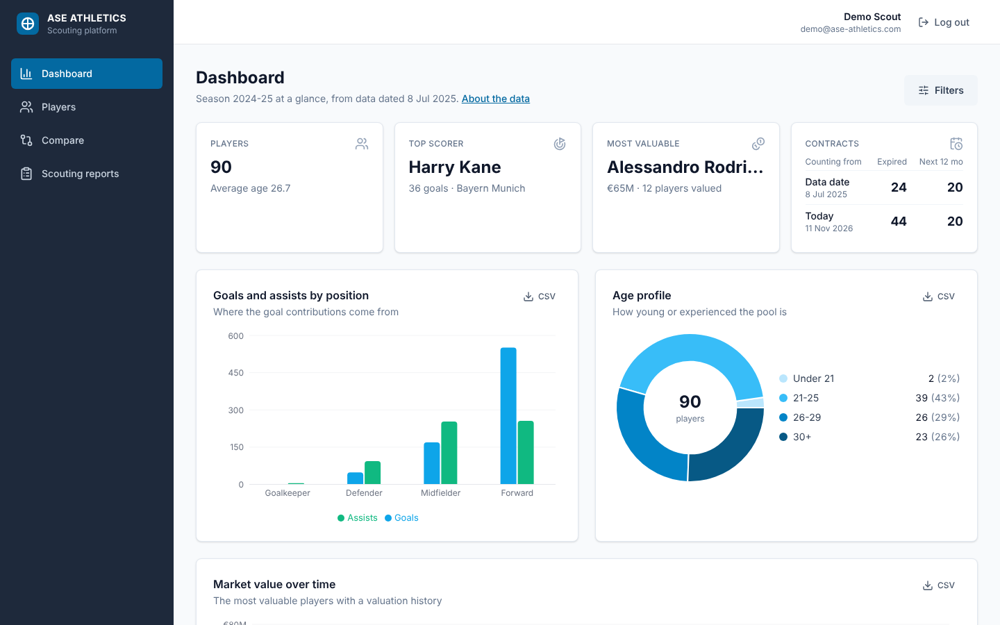
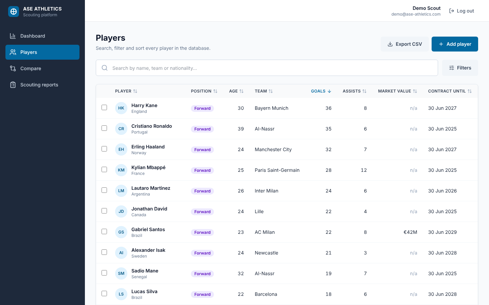
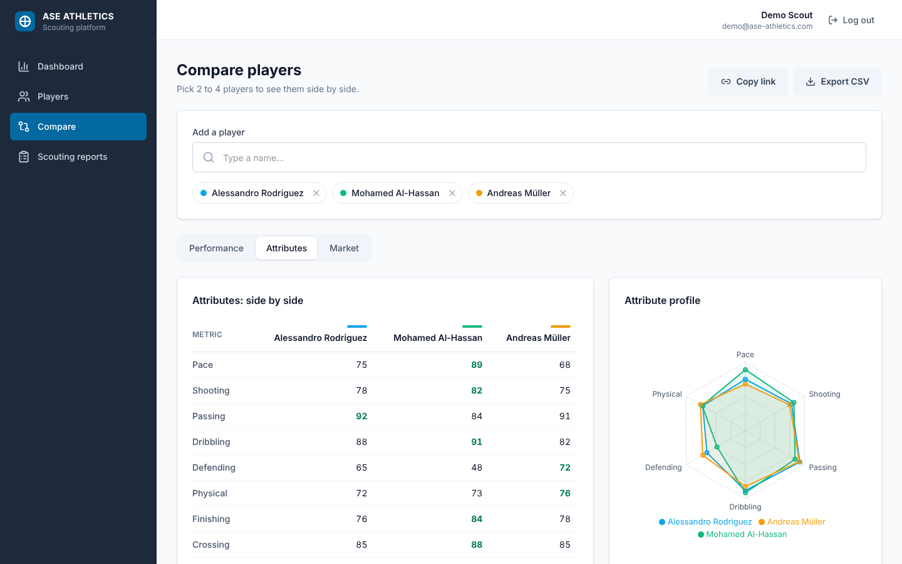
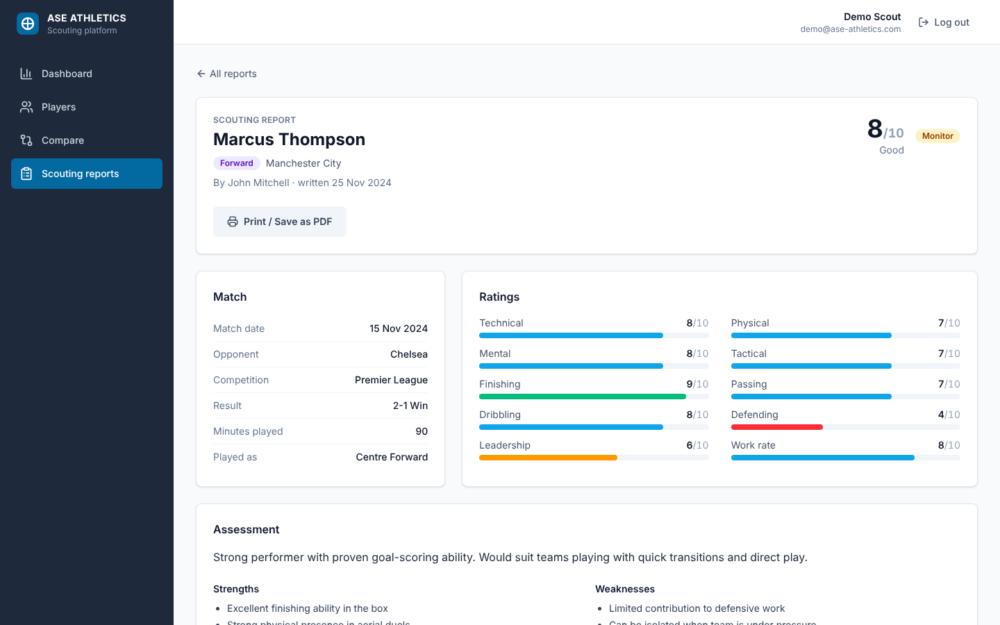
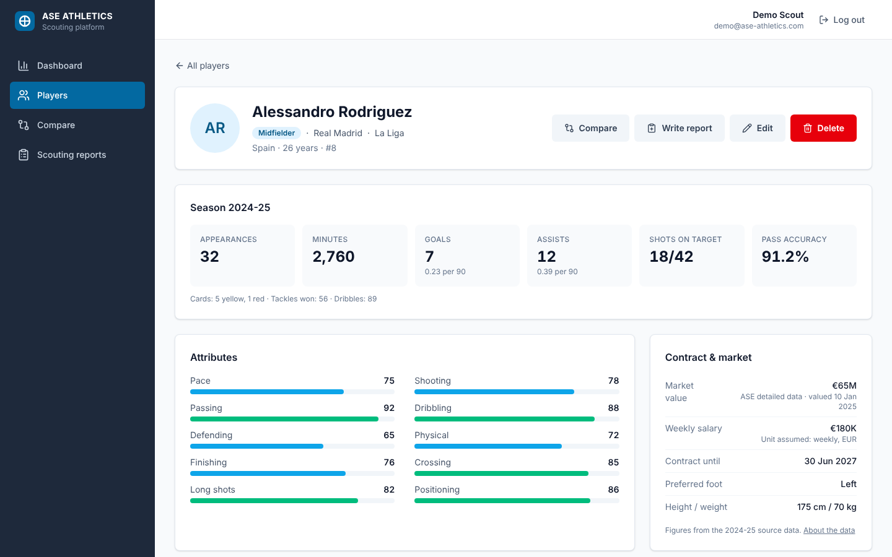
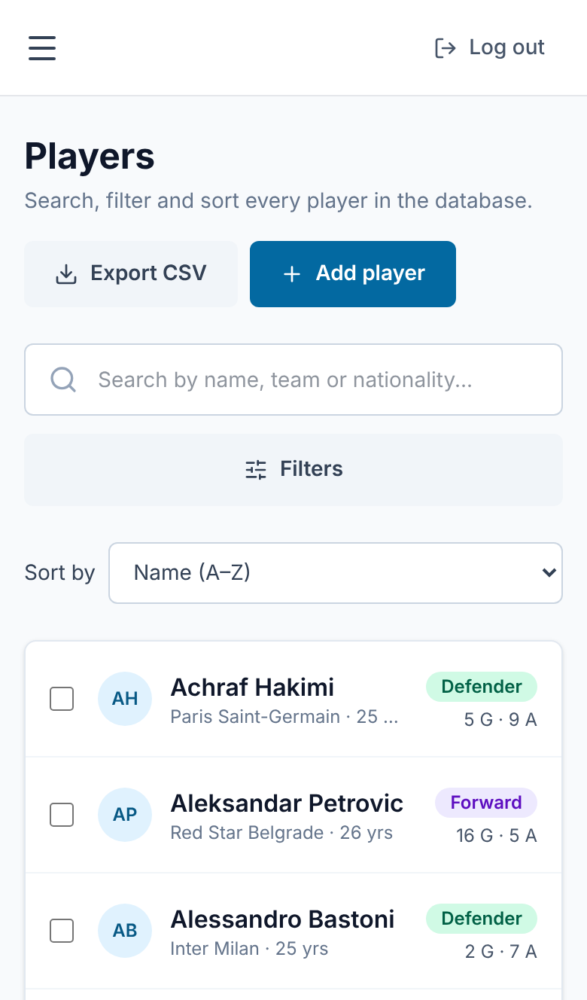
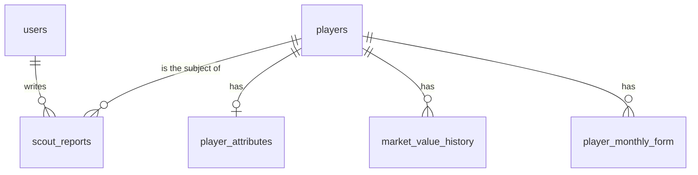

# ASE Athletics Scouting Platform

A full-stack football scouting app: search and filter 90 players, compare them side by side, track the squad on an analytics dashboard, and write scouting reports.

Built by **Kristina Verbova** for the ASE Athletics technical assessment, November 2026.

| | |
|---|---|
| **Live app** | https://ase-athletics-assessment-delta.vercel.app |
| **API** | https://ase-athletics-assessment.onrender.com |
| **API docs (Swagger)** | https://ase-athletics-assessment.onrender.com/api/docs |
| **Demo login** | `demo@ase-athletics.com` / `demo123` (or press "Use the demo account") |

> **First load can take up to a minute.** The API runs on Render's free tier, which sleeps after 15 minutes without traffic. The app waits for it and says so if it takes long; after that everything is fast.



## Contents

- [Features](#features) · [Feature checklist](#feature-checklist)
- [Tech stack](#tech-stack)
- [Run it locally](#run-it-locally)
- [Tests and CI](#tests-and-ci)
- [Project structure](#project-structure)
- [Database](#database)
- [API](#api)
- [Key decisions](#key-decisions)
- [Data handling](#data-handling)
- [Security](#security)
- [Performance](#performance)
- [Deployment](#deployment)
- [What I'd do next](#what-id-do-next)
- [How this was built](#how-this-was-built)

## Documentation

| Document | What's in it |
|---|---|
| [Architecture](docs/architecture.md) | How the pieces fit together, the request lifecycle, where state lives, diagrams |
| [Decisions and rationale](docs/decisions.md) | Why each technology and design choice, alternatives considered, what was deliberately left out |
| [Database schema](docs/database-schema.md) | Diagram, every table, relationships, constraints, indexes, seeding |
| [API documentation](docs/api-documentation.md) | Every endpoint with request and response examples, status codes, rate limits |
| [Data quality](docs/data-quality.md) | Every issue in ASE's data and how it's handled |
| [Deployment guide](docs/deployment-guide.md) | Neon, Render, Vercel and CI setup, secrets, troubleshooting |
| [Challenges](docs/challenges.md) | Problems hit during the build, their causes, fixes and lessons |
| [Swagger UI](https://ase-athletics-assessment.onrender.com/api/docs) | Try every endpoint in the browser |

## Features

**Players**
- Search by name, team or nationality, with matches highlighted
- Filter by position, team, nationality, and ranges for age, market value, goals and assists
- Sort by any column; paginated; works as cards on phones
- Every filter, sort and page lives in the URL, so any view can be refreshed or shared as a link
- Add, edit and delete players with full validation
- Export the current view to CSV

**Player profile**
- Season stats with per-90 figures, attribute bars, market value history and month-by-month form
- Every value says where it came from: ASE's data, entered in the app, or missing from the source

**Compare**
- 2 to 4 players side by side: performance, attributes (radar chart) and market value
- Best value in each row highlighted; shareable link; CSV export

**Dashboard**
- KPIs, goals and assists by position, age profile, market value trends, top attributes, contracts ending soon
- Filter the whole dashboard with the same filters as the player list
- Contract figures shown from the data date and from today, side by side
- A data quality panel showing how complete each field is

**Scouting reports**
- Structured reports: match details, 10 ratings, strengths, weaknesses, key moments, recommendation
- Only the author can edit or delete a report; everyone can read them
- Print or save as PDF

**Throughout**
- Login and registration with JWT; protected routes
- Responsive from 320px phones to desktop
- Loading, empty and error states on every screen; toasts for actions
- Keyboard accessible, labelled for screen readers, colours checked for contrast and colour blindness

| Players | Compare | Scouting report |
|---|---|---|
|  |  |  |

| Player profile | Phone |
|---|---|
|  |  |

## Feature checklist

| Brief requirement | Status | Where |
|---|---|---|
| User authentication and session management | ✅ | Register, login, logout, JWT, protected routes, auto-logout on expiry, rate limits |
| Complete player CRUD | ✅ | Players → Add, profile → Edit / Delete |
| Interactive analytics dashboard | ✅ | KPIs, 5 chart types, ranked lists, dashboard-wide filters |
| Advanced search and filtering | ✅ | Text search with highlights, multi-select filters, range sliders, sorting, pagination |
| Player comparison tool | ✅ | 2 to 4 players, three tabs, radar and trend charts |
| Scouting reports system | ✅ | Structured reports, 10 ratings, recommendation, author-only editing |
| Responsive design | ✅ | 320px phones to desktop |
| Data export | ✅ | CSV for players, comparisons and every dashboard chart; reports print to PDF |
| API documentation | ✅ | Swagger UI + [docs/api-documentation.md](docs/api-documentation.md) |

**Bonus features**

| Bonus | Status |
|---|---|
| Search suggestions / autocomplete | ✅ Player picker in Compare and reports |
| Filter state persistence during session | ✅ URL + session storage |
| Shareable comparison URLs | ✅ Copy link |
| Export chart data | ✅ CSV on every chart |
| Export to PDF | ✅ Scouting reports (print / save as PDF) |
| Unit, API and component tests | ✅ 43 API + 12 frontend, in CI |
| Production deployment, secrets management, hosted DB | ✅ Vercel, Render, Neon |
| CDN for static assets | ✅ Vercel's edge network |
| Export comparison as image / PDF | ➖ CSV and shareable link instead |
| Image upload | ➖ Initials avatars; see [what was left out](docs/decisions.md#deliberately-not-done-and-why) |
| Real-time updates (WebSockets) | ➖ Not needed for this data; see the same section |

## Tech stack

| Layer | Choice |
|---|---|
| Frontend | React 19, Vite, React Router, Context API, Tailwind CSS 4, Recharts, Axios |
| Backend | Node.js, Express 5, Joi validation, JWT + bcrypt, Helmet, Swagger UI |
| Database | PostgreSQL on Neon, Prisma ORM |
| Testing | Jest + Supertest (API), Vitest + Testing Library (frontend), GitHub Actions |
| Hosting | Vercel (frontend), Render (API), Neon (database) |

## Run it locally

You need Node.js 22 (or 20.19+) and a PostgreSQL database (a free [Neon](https://neon.tech) project works).

**1. Clone and install**

```bash
git clone https://github.com/krisverbnu/ase-athletics-assessment.git
cd ase-athletics-assessment
cd backend && npm install
cd ../frontend && npm install
```

**2. Set up environment variables**

```bash
cp backend/.env.example backend/.env
cp frontend/.env.example frontend/.env
```

| File | Variable | What it is |
|---|---|---|
| `backend/.env` | `DATABASE_URL` | Pooled Postgres connection string (used by the app) |
| | `DIRECT_URL` | Direct Postgres connection string (used by migrations) |
| | `JWT_SECRET` | Any long random string, for signing login tokens |
| | `CLIENT_URL` | Frontend address allowed to call the API, e.g. `http://localhost:5173` (comma-separate several) |
| | `ALLOWED_EMAIL_DOMAINS` | Optional. Only these email domains can sign up, e.g. `aseathletics.com`. Leave empty to allow anyone |
| `frontend/.env` | `VITE_API_URL` | API address, e.g. `http://localhost:5001` |

**3. Create the tables and load the data**

```bash
cd backend
npx prisma migrate deploy
npm run db:seed        # add --dry-run to preview without writing
```

The seed cleans and merges ASE's JSON files in `data/` and creates the demo account.

**4. Start both servers** (two terminals)

```bash
cd backend && npm run dev     # API on http://localhost:5001
cd frontend && npm run dev    # app on http://localhost:5173
```

## Tests and CI

```bash
cd backend && npm test     # 43 tests
cd frontend && npm test    # 12 tests
```

- **Backend:** the data merge (90 players, no duplicates, no invented values), dashboard maths, login protection, validation, player create/edit/delete, report ownership, CORS, rate limiting and the sign-up domain rule. The database is replaced with a fake, so tests run in about 2 seconds with no network.
- **Frontend:** URL filters, formatting, chart data, and the contracts card rendered as a user sees it.
- **CI:** every push runs both test suites, the frontend lint and the production build on GitHub Actions.

## Project structure

```
ase-athletics-assessment/
├── data/                  ASE's source JSON files
├── docs/
│   ├── data-quality.md    Every data issue found and how it's handled
│   └── screenshots/
├── backend/
│   ├── prisma/
│   │   ├── schema.prisma  Database tables
│   │   ├── migrations/
│   │   └── seed.js        Cleans and merges the JSON into the database
│   ├── src/
│   │   ├── routes/        URL → controller
│   │   ├── controllers/   Read the request, send the response
│   │   ├── services/      Business logic and database queries
│   │   ├── validators/    Joi schemas for every input
│   │   ├── middleware/    Auth, validation, error handling
│   │   └── docs/          OpenAPI spec for Swagger
│   └── tests/
└── frontend/
    └── src/
        ├── pages/         One file per screen
        ├── components/    Reusable UI, grouped by feature
        ├── context/       Auth and toast state
        ├── services/      API calls
        ├── utils/         Formatting, filters, CSV, chart data
        └── tests/
```

## Database

PostgreSQL on Neon, managed with Prisma: 6 tables with foreign keys, enums, unique constraints and cascading deletes. Full detail in [docs/database-schema.md](docs/database-schema.md).



| Table | Holds |
|---|---|
| `users` | Login accounts; every user is a scout |
| `players` | Profile, season stats, contract and market value (missing values stay empty) |
| `player_attributes` | Ratings out of 100, one row per player |
| `market_value_history` | Valuations over time |
| `player_monthly_form` | Goals, assists and rating per month |
| `scout_reports` | Match context, 10 ratings, strengths, weaknesses, verdict; linked to a player and its author |

## API

Full interactive docs: [`/api/docs`](https://ase-athletics-assessment.onrender.com/api/docs). Everything except auth and health needs an `Authorization: Bearer <token>` header.

| Method | Endpoint | Purpose |
|---|---|---|
| POST | `/api/auth/register` | Create an account |
| POST | `/api/auth/login` | Log in, get a token |
| POST | `/api/auth/logout` | Log out |
| GET | `/api/auth/me` | Current user |
| GET | `/api/players` | List with search, filters, sort and pagination |
| GET | `/api/players/search?q=` | Quick name search (autocomplete) |
| GET | `/api/players/filters` | Options for the filter menus |
| GET | `/api/players/:id` | One player with attributes, value history and form |
| POST / PUT / DELETE | `/api/players/:id` | Create, update, delete |
| GET | `/api/dashboard/stats` | All dashboard numbers, with optional filters |
| GET | `/api/reports` | List reports, optionally for one player |
| GET | `/api/reports/:id` | One report |
| POST / PUT / DELETE | `/api/reports/:id` | Create, update (author only), delete (author only) |
| GET | `/api/health` | Health check |

Errors always look the same: `{ "error": { "message": "...", "details": [{ "field": "...", "message": "..." }] } }`, so the frontend can show the message and highlight the exact fields.

## Key decisions

| Decision | Why |
|---|---|
| **PostgreSQL + Prisma** instead of JSON files or MongoDB | The data is relational (players → attributes, value history, form, reports). Prisma gives typed queries, migrations and safe parameterised SQL. Pinned to v6, the stable release, rather than the newer major with breaking changes. |
| **Layered backend** (routes → controllers → services) | Each layer has one job, so business rules live in one place and can be tested without HTTP. |
| **Validation at the edge with Joi** | Every request is checked before any logic runs; unknown fields are dropped and all errors are returned at once. |
| **State in the URL** for filters, sort, page, compare and tabs | Views survive refresh and can be shared as links. Context API only holds what's truly global (login, toasts), so no Redux was needed. |
| **Dashboard maths on the server** | One request returns every figure, already filtered, so the browser does no heavy lifting and numbers are consistent everywhere. |
| **Code splitting** | Pages load when first opened, cutting the first download from 874 kB to 340 kB. |
| **Colours from ASE's guidelines, adjusted for accessibility** | Primary buttons use a darker blue from the same palette to pass WCAG AA contrast. Chart colours were checked for colour-blind separation. |
| **Free hosting split three ways** | Vercel, Render and Neon are each strong at one thing and free, with deploys on every push. |

The full reasoning for every technology and design choice, with alternatives considered and what was left out on purpose, is in [docs/decisions.md](docs/decisions.md).

## Data handling

ASE's data has real gaps, and handling them is part of the brief. The rule throughout: **never invent a number.** Missing values are stored as empty, shown as "Not available" with an explanation, sorted last, and can be filled in by a scout.

- **Merged two player files into 90 players.** The one player in both files was enriched, not duplicated. A retired player was skipped.
- **Market value exists for only 12 of 90 players.** No estimates; the gap is labelled everywhere and shown in the dashboard's data quality panel.
- **Salary has no unit.** It's treated as weekly in euros, and labelled as such.
- **The data is a snapshot from 8 July 2025.** Contracts are shown from that date and from today, side by side.
- **Monthly form had months with no year.** The year is inferred from the season.
- **One scout report pointed at a missing player.** It was re-linked by name.

Full details, with evidence for each decision: [`docs/data-quality.md`](docs/data-quality.md).

## Security

- Passwords hashed with bcrypt; never returned by the API
- JWT on every protected route, expiring after 1 day
- Authorisation as well as authentication: only a report's author can change or delete it (enforced by the API, tested)
- Every input validated and unknown fields stripped; body size limited
- Helmet security headers; CORS limited to the frontend's address
- The same message for an unknown email and a wrong password, so the login form can't reveal who has an account
- Rate limiting: 10 failed logins per account per 15 minutes (counted per account, so changing IP address doesn't help an attacker), and 5 sign-ups per connection per hour
- Optional company-only sign-up: set `ALLOWED_EMAIL_DOMAINS=aseathletics.com` and only those emails can register. Left open here so reviewers can create accounts
- Secrets only in environment variables, never in the repository

**Known gap: who can change players.** Reports are protected by author, but players are shared data, so any logged-in scout can edit or delete any player. In a real club tool I'd add roles: scouts can add and edit players, only a head of scouting can delete them. For production I'd also make sign-up invite-only or company-domain only, with email verification.

**Trade-off: token in localStorage.** The login token is stored in `localStorage` and sent as a header. That's simple and works across the frontend (Vercel) and API (Render), which are on different domains. The risk is that a cross-site scripting bug could read it. React escapes all rendered content and the app never injects raw HTML, which keeps that risk low. In production I'd serve both from the same domain and move the token to an `HttpOnly`, `Secure`, `SameSite` cookie, which JavaScript can't read at all. I didn't do that here because cross-domain cookies are increasingly blocked by browsers, and a broken login would be worse than a documented trade-off.

## Performance

- Indexes on every searched and filtered column; paginated lists (25 per page)
- One request for the whole dashboard, calculated on the server
- Autocomplete returns only the 5 fields it needs; search waits for a typing pause
- Pooled database connections through Neon and a single shared Prisma client
- Pages load on demand: first download cut from 874 kB to 340 kB
- Static frontend served from Vercel's CDN

At larger scale I'd move the dashboard aggregations into SQL and cache them. More in [docs/decisions.md](docs/decisions.md#performance).

## Deployment

Push to `main` and everything deploys itself: GitHub Actions runs the tests, Vercel rebuilds the frontend, Render rebuilds the API (when `backend/` changed) and applies any new database migrations. Secrets live only in each platform's settings. A small scheduled workflow keeps the free API awake during review.

Step-by-step setup, environment variables and troubleshooting: [docs/deployment-guide.md](docs/deployment-guide.md).

## What I'd do next

- Same-domain deploy with `HttpOnly` cookie sessions
- Roles (scout, head of scouting): only a head of scouting can delete players
- Invite-only or company-domain sign-up with email verification
- End-to-end tests (Playwright) running against a preview deploy
- Import market values from a licensed data provider, with source and date per value
- Saved searches and watch lists per scout

## AI Assistance

Claude Code was used to assist with development, implementation and debugging.

