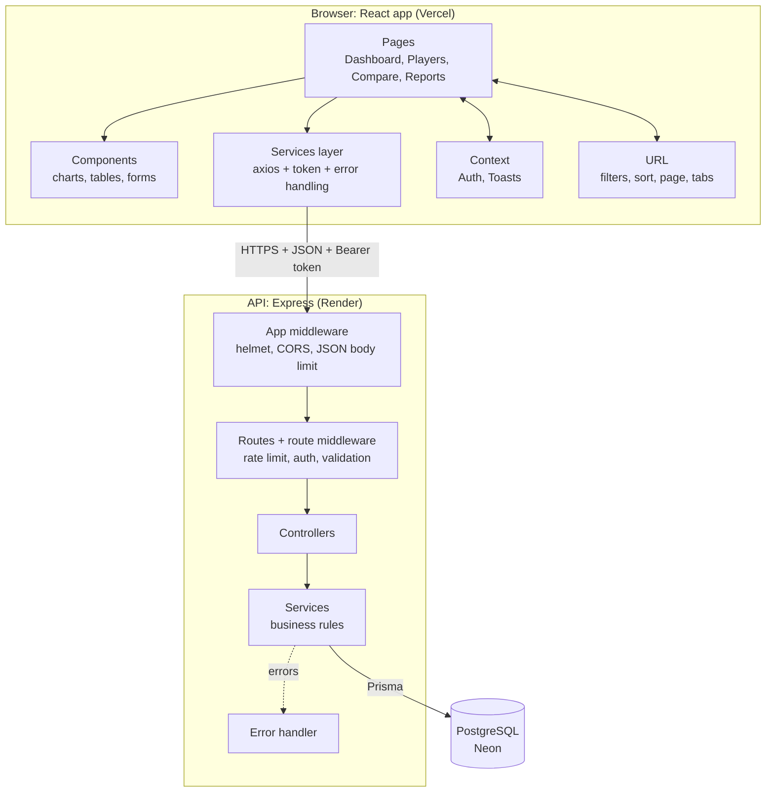
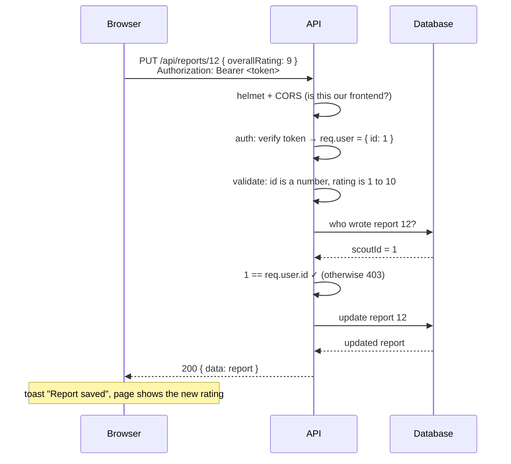

# Architecture

How the app is put together, and what happens when you click something.

## The big picture



## Backend: one job per layer

| Layer | Folder | Its job | Example |
|---|---|---|---|
| Routes | `src/routes/` | Map a URL and method to a controller, and list which middleware runs first | `router.put('/:id', validate(idParam), validate(updatePlayerSchema), controller.update)` |
| Middleware | `src/middleware/` | Things every request needs: check the token, validate input, limit attempts, format errors | `auth.js`, `validate.js`, `rateLimit.js`, `errorHandler.js` |
| Validators | `src/validators/` | Joi schemas: what a valid request looks like | Ages are whole numbers 15 to 50; ratings 1 to 10 |
| Controllers | `src/controllers/` | Read the request, call a service, send the response. No business rules | `res.status(201).json({ data: player })` |
| Services | `src/services/` | Business rules and database queries | "Only the author can edit a report"; dashboard maths |
| Utils | `src/utils/` | Shared pieces | the single Prisma client, `HttpError` |

**Why layers?** Each rule lives in exactly one place. The dashboard maths (`computeStats`) is a plain function that takes players and returns numbers, so it's tested without a server or a database. Swapping Express for another framework, or Prisma for another ORM, would only touch one layer.

### What happens when a scout edits a report



If any step fails, the request jumps straight to the error handler, which always answers in the same shape: `{ "error": { "message", "details" } }`. Express 5 forwards errors from async code automatically, so no controller needs its own try/catch.

## Frontend: where things live

| Folder | What's inside |
|---|---|
| `src/pages/` | One file per screen. A page fetches its data, owns its state, and arranges components |
| `src/components/` | Reusable UI grouped by feature: `common/` (buttons, fields, states), `dashboard/`, `compare/`, `players/`, `filters/`, `layout/` |
| `src/services/` | The only code that talks to the API. Pages call `getPlayers(filters)`, never axios directly |
| `src/context/` | App-wide state: who is logged in (`AuthContext`), and toast messages (`ToastContext`) |
| `src/hooks.js` | `useApi`: loads data with loading and error states built in |
| `src/utils/` | Pure helpers: formatting, URL filters, CSV export, chart data, chart styling |
| `src/tests/` | Vitest tests |

The brief suggests a `store/` folder for state management. This app doesn't need one; see "State" below.

### State: what lives where

| State | Where | Why |
|---|---|---|
| Who's logged in, the token | `AuthContext` + `localStorage` | Needed everywhere; survives a refresh |
| Toast messages | `ToastContext` | Any page can show one |
| Filters, search, sort, page, compare selection, active tab | **The URL** (`?position=Forward&sort=goals&page=2`) | Refresh keeps your view; the back button works; any view can be shared as a link |
| Last player filters for the session | `sessionStorage` | Returning to Players brings your filters back (a brief bonus), cleared when the tab closes |
| Data from the API | Inside each page, via `useApi` | Each page owns its data; no global cache to keep in sync |
| Form input | `useState` in the form | Local by nature |

This covers everything a Redux store would, with less code: URL for anything shareable, Context for the two truly global things, and local state for the rest.

### The services layer

`src/services/api.js` sets up one axios instance used for every call:

1. **Before each request:** attach the token from `localStorage`.
2. **After each response:** if the API says `401` (token expired), fire an `auth:expired` event; `AuthContext` logs the user out and sends them to the login page.
3. **Errors become sentences:** `getErrorMessage()` turns any failure into something a user can read ("Cannot reach the server...", or the API's own message). `getFieldErrors()` turns validation `details` into `{ field: message }` so forms highlight the exact inputs.
4. **Timeout 60 seconds**, because the free API can take about 50 seconds to wake up.

### Loading data: `useApi`

```js
const { data, loading, error, reload } = useApi(() => getPlayer(id), [id]);
```

Every page shows a skeleton while `loading`, an error with a "Try again" button (`reload`) on `error`, and an empty state when there's nothing to show. The hook tags each request with its inputs, so if you click quickly between players, a slow old answer can never overwrite the new one.

## Cross-cutting concerns

| Concern | How it's handled |
|---|---|
| **Security** | Hashed passwords, JWT on every protected route, author-only report edits, rate limits, validation and stripping of unknown fields, Helmet headers, strict CORS. Details and trade-offs in the [README](../README.md#security) |
| **Errors** | One error format from the API; one error-to-message function on the frontend; every page has loading, error and empty states |
| **Accessibility** | Labelled inputs, keyboard navigation, visible focus, screen-reader text for icons and charts, colour never the only signal, motion off for "reduce motion" users |
| **Responsive design** | Tables become cards on phones; tested from 320px to 1440px with no sideways scrolling |
| **Performance** | Indexed columns, paginated lists, one request per dashboard, pages loaded on demand. See [decisions.md](decisions.md#performance) |
| **Missing data** | Never shown as 0; labelled with its source. See [data-quality.md](data-quality.md) |
| **Testing** | 43 API tests and 18 frontend tests, run on every push. See the [README](../README.md#tests-and-ci) |
