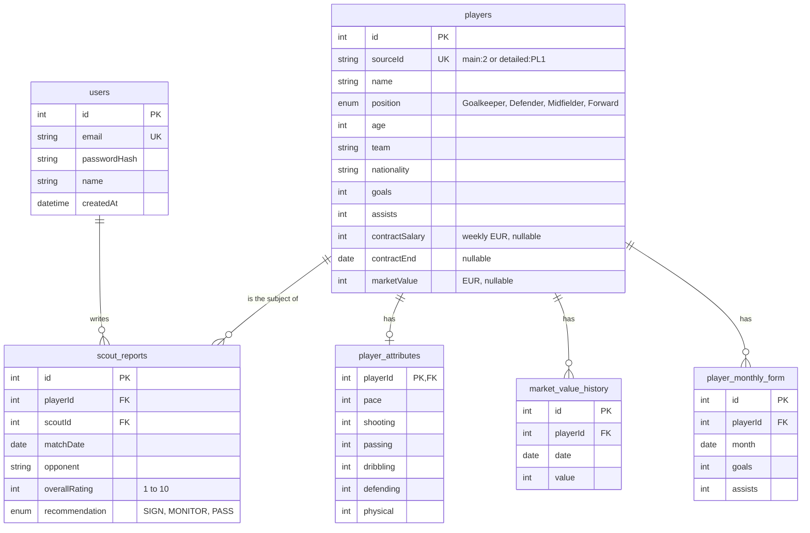

# Database schema

PostgreSQL (hosted on Neon), managed with Prisma. The source of truth is [`backend/prisma/schema.prisma`](../backend/prisma/schema.prisma); the SQL it produces is in [`backend/prisma/migrations/`](../backend/prisma/migrations/).

## Diagram



The diagram shows the key columns; every column is listed below.

## Relationships

| Relationship | Type | What happens on delete |
|---|---|---|
| A **player** has **attributes** | One to one (optional) | Deleting the player deletes the attributes |
| A **player** has a **market value history** | One to many | Deleted with the player |
| A **player** has **monthly form** rows | One to many | Deleted with the player |
| A **player** has **scouting reports** | One to many | Deleted with the player |
| A **user** (scout) writes **scouting reports** | One to many | A user with reports can't be deleted (protects the reports) |

**Why separate tables instead of one wide `players` table?**

- **Attributes** only exist as a set (all six core ratings or none), and goalkeepers have different ones (diving, handling...). A separate table keeps `players` readable and makes "has ratings" a single check.
- **Market value history** and **monthly form** are lists over time. A list can't live in one column without losing the ability to sort, filter and chart it, so each point is a row.
- **Reports** have their own author, dates and lifecycle.

Each "has many" table is keyed back to the player with a foreign key, so the database itself guarantees that every value point, form row and report belongs to a real player.

## Tables

### `users`
Login accounts. Every user is also a scout who can write reports.

| Column | Type | Notes |
|---|---|---|
| `id` | integer, primary key | Auto-increment |
| `email` | text, **unique** | No two accounts with the same email |
| `passwordHash` | text | bcrypt hash (10 rounds); the real password is never stored |
| `name` | text | Shown on reports and in the header |
| `createdAt` | timestamp | Set automatically |

### `players`
The core table: one row per player.

| Group | Columns | Notes |
|---|---|---|
| Identity | `id`, `sourceId` (unique), `name`, `position` (enum), `detailedPosition`, `age`, `team`, `league`, `nationality`, `height` (cm), `weight` (kg), `preferredFoot`, `jerseyNumber`, `imageUrl` | `sourceId` records which file and record a seeded player came from (e.g. `main:2`), so every row can be traced back to ASE's data. Players added in the app have none |
| Season stats | `appearances`, `goals`, `assists`, `minutesPlayed`, `yellowCards`, `redCards` | Default 0 |
| Detailed stats | `passAccuracy`, `shotsOnTarget`, `totalShots`, `dribblesCompleted`, `tacklesWon`, `aerialDuelsWon`, `saves`, `cleanSheets`, `goalsConceded` | Nullable: outfield and goalkeeper stats only apply to some players |
| Contract and market | `contractSalary` (weekly EUR), `contractEnd` (date), `marketValue` (EUR) | **Nullable on purpose**: missing means "not known", never 0. See [data-quality.md](data-quality.md) |
| Timestamps | `createdAt`, `updatedAt` | Set automatically |

### `player_attributes`
Ratings out of 100, one row per player. `playerId` is both the primary key and the foreign key, which enforces "at most one set of attributes per player".

Core (required): `pace`, `shooting`, `passing`, `dribbling`, `defending`, `physical`.
Optional: `positioning`, `finishing`, `crossing`, `longShots` (outfield); `diving`, `handling`, `kicking`, `reflexes` (goalkeepers).

### `market_value_history`
`id`, `playerId`, `date`, `value` (EUR), `source`. **Unique on (`playerId`, `date`)**: one valuation per player per day.

### `player_monthly_form`
`id`, `playerId`, `month` (first day of the month), `appearances`, `goals`, `assists`, `averageRating`. **Unique on (`playerId`, `month`)**.

### `scout_reports`

| Group | Columns |
|---|---|
| Links | `playerId` → players, `scoutId` → users |
| Match context | `matchDate`, `opponent`, `competition`, `venue`, `result`, `minutesPlayed`, `positionPlayed` |
| Ratings (1 to 10) | `technical`, `physical`, `mental`, `tactical`, `finishing`, `passing`, `dribbling`, `defending`, `leadership`, `workRate`, `overallRating` |
| Evaluation | `strengths`, `weaknesses`, `keyMoments` (PostgreSQL text arrays), `recommendation` (enum), `summary`, `notes` |
| Timestamps | `createdAt`, `updatedAt` |

Strengths, weaknesses and key moments are stored as native PostgreSQL arrays: they're short lists that are always read and written together with the report, so a separate table would add joins without adding value.

## Validation at the database level

The API validates every request first (Joi), and the database enforces the rules that must never break, even if a bug or a manual edit got past the API:

| Rule | How |
|---|---|
| Positions and recommendations are from a fixed list | PostgreSQL **enums** (`Position`, `Recommendation`) |
| Emails are unique | `UNIQUE` on `users.email` |
| A seeded player is never imported twice | `UNIQUE` on `players.sourceId` |
| One valuation per player per date; one form row per player per month | Composite `UNIQUE` constraints |
| Every attribute set, value point, form row and report belongs to a real player; every report to a real user | **Foreign keys** |
| Removing a player removes their dependent data | `ON DELETE CASCADE` on all player relations |
| Required fields are present | `NOT NULL` on required columns |
| Dates are dates, not text | `DATE` columns for contract end, match dates, months |

Range checks (ages, ratings 1 to 10, attributes 1 to 100) are enforced by the API's validators, which return a clear message per field.

## Indexes

| Index | Why |
|---|---|
| `players(name)`, `players(team)`, `players(nationality)`, `players(position)` | The columns used by search, filters and sorting |
| `scout_reports(playerId)`, `scout_reports(scoutId)` | Listing reports for a player or by a scout |
| Primary keys and unique constraints | Indexed automatically |

## Connections and pooling

Two connection strings, both from Neon:

| Variable | Used by | Why |
|---|---|---|
| `DATABASE_URL` | The running app | Goes through Neon's **connection pooler** (PgBouncer), so many requests share a small number of database connections. Important on serverless databases, which limit connections |
| `DIRECT_URL` | Prisma migrations | Migrations need a direct connection; the pooler doesn't support everything they do |

The app uses a single shared Prisma client (`backend/src/utils/prisma.js`), so it never opens a new pool per request.

## Migrations and seeding

```bash
cd backend
npx prisma migrate deploy   # create or update the tables from the migration files
npm run db:seed             # load ASE's data (add --dry-run to preview without writing)
npm run db:studio           # browse the data in a web UI
```

The seed script (`backend/prisma/seed.js`):

1. **Clears every table** (including user accounts), then reads the JSON files in `data/`. Re-running it resets the database to ASE's original data, so don't run it against a database with work you want to keep.
2. Merges the two player files into 90 players (one player appears in both and is enriched rather than duplicated; one retired player is skipped).
3. Creates attributes, market value history and monthly form for the players that have them, inferring the missing year on month labels.
4. Creates a user account for each scout in the reports file, plus the demo account (`demo@ase-athletics.com` / `demo123`).
5. Imports the scouting reports, re-linking one report whose player id doesn't exist.

Every decision the seed makes about the data is explained in [data-quality.md](data-quality.md), and covered by tests in `backend/tests/seed.test.js`.
