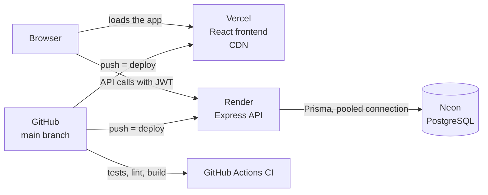

# Deployment guide

The app runs on three free services, each doing one job:



| Part | Service | Live address |
|---|---|---|
| Frontend | Vercel | https://ase-athletics-assessment-delta.vercel.app |
| API | Render (web service, free plan) | https://ase-athletics-assessment.onrender.com |
| Database | Neon (serverless PostgreSQL, free plan) | Private; connection strings in environment variables only |

**Why this split:** each service is strong at one thing and free. Vercel serves static files from a global CDN, Render runs a normal long-lived Node server (no rewrite into serverless functions needed), and Neon gives managed PostgreSQL with built-in connection pooling. All three deploy automatically from GitHub.

## 1. Database: Neon

1. Create a Neon project, ideally in a region close to where the API runs (fewer milliseconds per query).
2. From **Connection details**, copy two strings:
   - the **pooled** one (host contains `-pooler`) → `DATABASE_URL`
   - the **direct** one → `DIRECT_URL`
3. Create the tables and load the data from your computer, with `backend/.env` pointing at Neon:
   ```bash
   cd backend
   npx prisma migrate deploy
   npm run db:seed
   ```
   The seed clears all tables first, so run it only on a new or disposable database.

## 2. API: Render

Create a **Web Service** from the GitHub repo:

| Setting | Value |
|---|---|
| Root directory | `backend` |
| Runtime | Node |
| Build command | `npm install && npx prisma generate && npx prisma migrate deploy` |
| Start command | `npm start` (runs `node src/index.js`) |
| Plan | Free |

The build command installs packages, generates the Prisma client, and applies any new migrations, so a schema change deploys itself safely (migrations only ever move forward).

**Environment variables** (Render → Environment):

| Variable | Value |
|---|---|
| `DATABASE_URL` | Neon pooled connection string |
| `DIRECT_URL` | Neon direct connection string |
| `JWT_SECRET` | A long random string (e.g. `openssl rand -hex 32`). Never reuse the local one |
| `CLIENT_URL` | The Vercel address, exactly: `https://ase-athletics-assessment-delta.vercel.app`. Comma-separate several |
| `ALLOWED_EMAIL_DOMAINS` | Optional. e.g. `aseathletics.com` to allow only company emails to sign up. Empty = anyone |

`PORT` is set by Render automatically; the app reads it (and uses 5001 locally).

Check it worked: `https://<your-service>.onrender.com/api/health` returns `{"status":"ok"}`, and `/api/docs` shows Swagger UI.

## 3. Frontend: Vercel

Import the repo as a new project:

| Setting | Value |
|---|---|
| Root directory | `frontend` |
| Framework preset | Vite |
| Build command | `npm run build` (default) |
| Output directory | `dist` (default) |

**Environment variable:** `VITE_API_URL` = the Render address, with no `/api` and no trailing slash, e.g. `https://ase-athletics-assessment.onrender.com`.

Vite only exposes variables starting with `VITE_`, and bakes them in **at build time**: after changing it, redeploy.

`frontend/vercel.json` sends every path to `index.html`, so links like `/players/12` work when opened directly or refreshed (the React router takes over from there):

```json
{ "rewrites": [{ "source": "/(.*)", "destination": "/" }] }
```

## 4. Continuous integration: GitHub Actions

`.github/workflows/ci.yml` runs on every push and pull request:

| Job | Steps |
|---|---|
| Backend | `npm ci` → `npm test` (Jest + Supertest, fake database, no secrets needed) |
| Frontend | `npm ci` → `npm run lint` → `npm test` (Vitest) → `npm run build` |

A red ✗ on a commit means something broke before anyone has to click through the app.

`.github/workflows/keep-awake.yml` pings `/api/health` every 5 minutes (GitHub sometimes runs scheduled jobs late, so 5 leaves margin) so the free Render instance doesn't fall asleep while the app is being reviewed (see Free-plan limits below). Disable it in the Actions tab when no longer needed.

## Releasing a change

1. Commit and push to `main`.
2. CI runs the tests.
3. **Vercel** rebuilds the frontend (about 30 seconds).
4. **Render** rebuilds the API, but only when something in `backend/` changed (about 2 to 3 minutes). Render's Events page shows each deploy as *Live* or *Failed*.
   On startup the API checks that `DATABASE_URL`, `JWT_SECRET` and `CLIENT_URL` are set and refuses to start otherwise, so a deploy with a missing setting shows as *Failed* and the previous version stays live. When Render replaces the old server, it sends `SIGTERM`: the API stops taking new requests, lets the ones in progress finish, closes the database connection, then exits.
5. If a deploy breaks something: Vercel → Deployments → *Instant Rollback*, or Render → Events → *Rollback* on the last good deploy.

## Secrets management

- Secrets live **only** in each platform's environment settings and in local `.env` files.
- `.env` and `.env.*` are in `.gitignore`; only `.env.example` files (with placeholders) are committed.
- The repository history was checked for connection strings and secrets before it was made public.
- If a secret is ever exposed: generate a new one, update it on the platform, redeploy. (Done once during development for `JWT_SECRET`.)

## Free-plan limits and how they're handled

| Limit | Effect | Mitigation |
|---|---|---|
| Render free instances sleep after 15 minutes without traffic | The first request after a quiet period can take about 50 seconds | The frontend waits up to 60 seconds before giving up, and its error message says the server may be waking up; the keep-awake workflow prevents sleep during review |
| Neon free compute suspends when idle | The first query after a pause takes a moment longer | Handled transparently by Neon; the API's error handler returns a clean message if a query ever fails |
| Render scheduled maintenance (e.g. 18 Nov 2026, 03:00 Madrid time) | Brief downtime | Nothing to do; not caused by the app |

## Troubleshooting

| Symptom | Likely cause | Fix |
|---|---|---|
| Render deploy fails and the log says **Missing environment variables: ...** | A required setting is missing on Render | Add the variables it names in Render → Environment; the previous version stays live until a deploy succeeds |
| App says "Cannot reach the server" and the browser console says **blocked by CORS policy** | `CLIENT_URL` on Render doesn't exactly match the frontend address | Set it exactly (the API now ignores a trailing `/`), save, redeploy |
| "Cannot reach the server", console shows a timeout | API asleep or down | Open `/api/health`, wait, try again; check Render Events |
| Frontend calls `undefined/api/...` | `VITE_API_URL` missing on Vercel, or set after the last build | Set it and redeploy |
| Render deploy fails at `prisma migrate deploy` | `DIRECT_URL` missing or wrong | Check both Neon strings |
| Render deploy fails with "Cannot find module" | A package was used in code but not saved in `package.json` | `npm install <package>` locally, commit `package.json` and `package-lock.json` |
| Locally, `localhost:5000` returns 403 | macOS AirPlay uses port 5000 | The API uses 5001 |
| Locally, Vite starts on 5174 and login fails | An old dev server is still holding 5173, and the API only allows 5173 | `lsof -ti :5001 -ti :5173 -ti :5174 \| xargs kill`, then restart both |

More detail on each of these is in [challenges.md](challenges.md).
